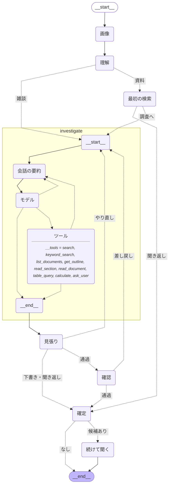

# 回答の流れ（生成物）

`make graph` が `api/src/arag/agent/flow.py` のグラフの定義から書き出す。手で直さない
（CI の `graph-check` が一致を確かめる）。仕様は `specs/029-explicit-graph/`。
「調査」の中は create_agent（モデル ⇄ ツールの輪）。

| 節点 | 表示名 | 役目 |
|---|---|---|
| `read_image` | 画像 | 添付画像を文章にして質問に添える（画像が無ければ素通り） |
| `understand` | 理解 | 質問の種類・検索語・表の集計の要否を整理する（初回は質問文での検索と並行） |
| `primer_search` | 最初の検索 | 整理した検索語で検索し、結果を質問に添える用意をする |
| `investigate` | 調査 | モデルとツールの輪（create_agent。要約・モデルの切り替え・回数の上限を含む） |
| `guard` | 見張り | 空の生成のやり直し・差し戻しへの返事や引用の消えた書き直しの取り消し |
| `review` | 確認 | 調べ残し・表の集計・数字を確かめ、当てはまれば差し戻す（種類ごとに 1 度） |
| `finalize` | 確定 | 数字の照合・引用の整形と刈り込み・回答の分類をして、完了を送る |
| `followups` | 続けて聞く | 完了の後に、続けて聞く質問の候補を作って届ける |

辺の札: `chat` = 雑談・`docs` = 資料・`retry` = やり直し・`use_draft` = 下書き・聞き返し・`investigate` = 調査へ・`clarify` = 聞き返し・`ok` = 通過・`send_back` = 差し戻し・`pass` = 通過・`followups` = 候補あり・`end` = なし
